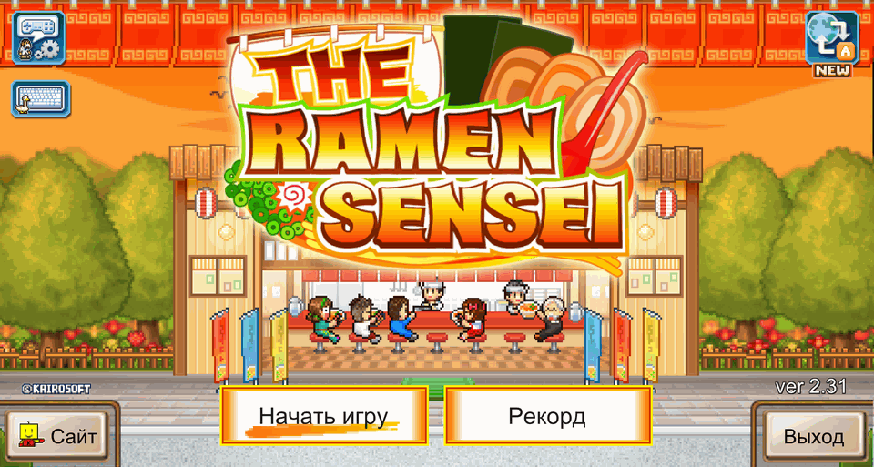
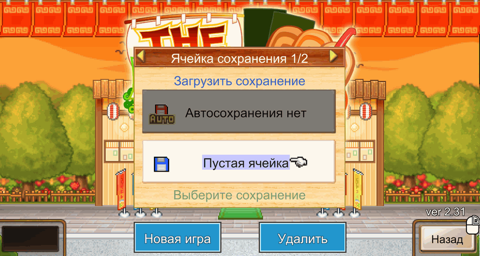
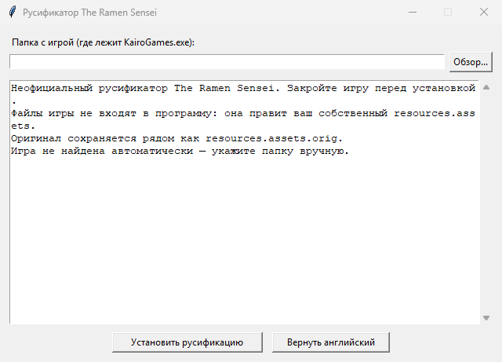

# The Ramen Sensei — русификатор

[](https://github.com/DomenicoCano/The-Ramen-Sensei-RU/releases/latest/download/TheRamenSensei_RU_Installer.exe)

Неофициальный перевод на русский язык игры **The Ramen Sensei** (Kairosoft): весь интерфейс, диалоги, обучение, рецепты и ингредиенты лапши и бульонов, топпинги, комбо, арены, конкурсы, вложения, названия районов и выпуски газеты «Новости лапши» — **2583 уникальные строки** (3599 текстовых ячеек в игровых таблицах).

<p align="center">
  
</p>

| Выбор сохранения | Окно установщика |
|---|---|
|  |  |

## Установка

1. Закройте игру.
2. Скачайте [`TheRamenSensei_RU_Installer.exe`](https://github.com/DomenicoCano/The-Ramen-Sensei-RU/releases/latest/download/TheRamenSensei_RU_Installer.exe).
3. Запустите установщик. Если положить exe рядом с папкой игры (или если игра установлена в Steam), она найдётся сама; иначе нажмите **«Обзор...»** и выберите папку, где лежит `KairoGames.exe`.
4. Нажмите **«Установить русификацию»** — через пару секунд всё будет готово. Запускайте игру.

**Удаление:** кнопка **«Вернуть английский»** в том же окне восстанавливает оригинальный `resources.assets` из резервной копии `resources.assets.orig`.

## Что делает установщик

- Файлов игры в программе **нет**: она читает и правит **ваш собственный** `KairoGames_Data\resources.assets` (расшифровывает архив таблиц `xls`, применяет перевод к `English.lproj`, зашифровывает и сохраняет обратно).
- Оригинал сохраняется рядом с именем `resources.assets.orig`; запись идёт через временный файл `resources.assets.tmp` с атомарной заменой `os.replace`.
- Перевод подставляется по шаблону `language_pack_template_en` и по английским строкам: если в обновлении игры появятся новые строки, они останутся на английском, а остальной перевод продолжит работать.
- Если структура `resources.assets` не подошла, установщик сообщит об этом и **ничего не изменит**.
- После установки язык в реестре Windows (`HKCU\Software\Kairosoft\こだわりラーメン館\_language_pack_h56009614`) переключается на `*English`, в который встроен русский перевод.

### Автоприменение после обновлений (Steam)

В Steam: *Свойства игры → Параметры запуска*:

```
"<путь>\TheRamenSensei_RU_Installer.exe" %command%
```

Установщик тихо применит русификацию, если обновление игры вернуло оригинальные файлы, и сразу запустит игру. (Этот режим в живом Steam-клиенте не проверялся.)

## Что проверено

- Версия игры: сборка с надписью **ver 2.31** на титульном экране.
- Автопроверка всех 20 файлов перевода (`2583/2583` строк, совпадение количества тегов `<...>`, сегментов `|` и экранированных последовательностей без ошибок).
- В самой игре по скриншотам проверены главный экран (включая кнопку «Выход») и экран выбора ячейки сохранения.
- Установка, повторная установка и восстановление оригинала проверены с собранного `TheRamenSensei_RU_Installer.exe`: выходной `resources.assets` совпал побайтно с эталонной сборкой (`16 148 024` байт), а восстановленный — с исходным (`16 058 492` байт). Пройден `scan_privacy.py` (0 совпадений).

## Известные ограничения

- Внутриигровые экраны после запуска сохранения (стройка лавки, готовка, арены, газета, меню настроек) не просматривались вручную на скриншотах после финальной правки — отдельные длинные фразы могут тесно ложиться в узкие таблицы. Если заметите, создайте [issue](https://github.com/DomenicoCano/The-Ramen-Sensei-RU/issues) со скриншотом.
- Русский текст заменяет английский слот (`English`): выбирать в меню выбора языка (иконка глобуса) нужно **English**.
- Неподписанный exe, собранный PyInstaller, может вызывать предупреждение Windows SmartScreen или антивируса. Исходники лежат в `src/`, exe можно собрать самостоятельно, а контрольная сумма релиза приведена ниже.
- Около 400 служебных строк `lib.language` (меню выбора языка, системные диалоги KairoLibrary) не входят в таблицы `xls` и остаются на английском.

## Сборка из исходников

Нужны Python 3.10.1+ (рекомендуется Python 3.12; на 3.10.0 PyInstaller падает в модуле `dis`) и пакеты `UnityPy`, `pyinstaller`, `pillow`:

```bat
cd src
build.bat
```

Результат: `src\dist\TheRamenSensei_RU_Installer.exe`. Весь словарь перевода, ключ и правки ячеек хранятся в `src\data\ru.json`.

## Контрольная сумма

SHA-256 файла `TheRamenSensei_RU_Installer.exe` (`24 869 039` байт):

```
bdead262654ecc3193b9411e4b3604de2f8d0141df5cbf4813f92cc20cbee753
```

## Состав репозитория

| Путь | Что это |
|---|---|
| `src/ru_installer.py` | GUI-установщик (поиск игры, распаковка/сборка `xls` в `resources.assets`, откат `.orig`, тихий режим для Steam) |
| `src/data/ru.json` | Полный перевод на русский язык (2583 уникальные строки + дополнительные ячейки) |
| `src/build.bat` | Скрипт сборки exe через PyInstaller |
| `docs/` | Скриншоты игры и установщика |

*(Сам `TheRamenSensei_RU_Installer.exe` в дерево репозитория не коммитится и публикуется только в разделе [Releases](https://github.com/DomenicoCano/The-Ramen-Sensei-RU/releases).)*

## Важно

Проект неофициальный и не связан с Kairosoft. Предназначен только для **легально приобретённых копий** игры. Файлы самой игры в репозитории и в установщике не распространяются.
